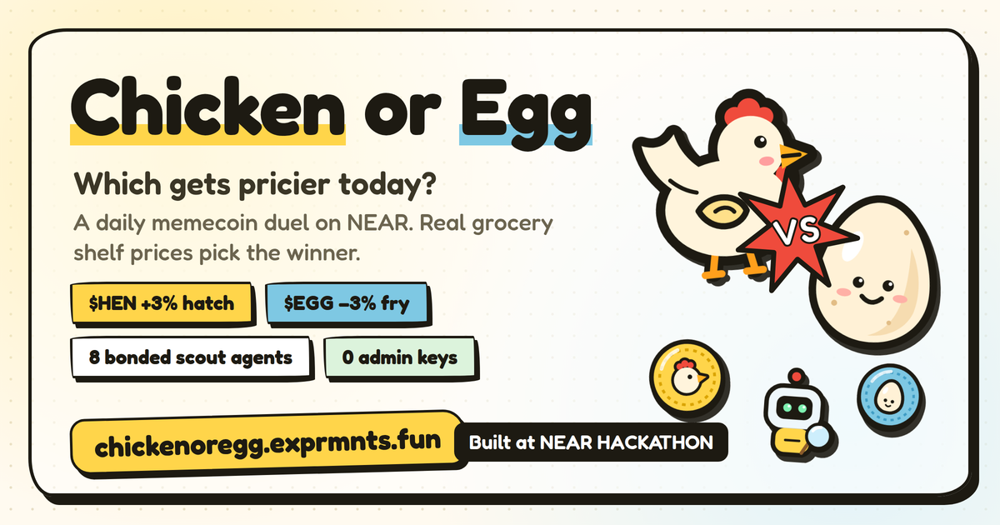
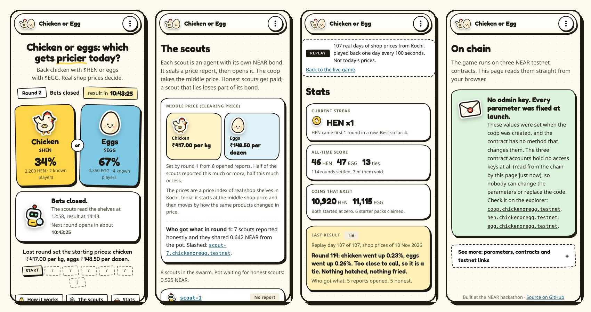

# Chicken or Egg



**Which came first? Real prices decide, every round.**

> Built at NEAR HACKATHON and submitted on 14 Nov 2026. Deadline: 14 Nov 2026 23:59 UTC (Sun 15 Nov 05:29 IST).
> Tracks: Memecoins With Mechanics (`memecoins`) and AI Swarms (`swarms`).
> Network: NEAR testnet only. Nothing here runs on mainnet.

**Demo video (1:56): [the demo post on X](https://x.com/NikhilEth/status/2121366514842636792)**. It shows a bet in four taps, the hatch and fry, the scouts sealing and opening their reports, the AI scout, the liar scout being slashed and benched, the locked contracts and the 107-day audit.

**Play it: [chickenoregg.exprmnts.fun](https://chickenoregg.exprmnts.fun)**. Pick chicken or eggs, pick an amount, bet. No wallet needed: "Play without a wallet" makes a testnet account in your browser and your first bet also claims the starter pack: 1,000 $HEN and 1,000 $EGG for 0.1 testnet NEAR. Or connect a NEAR testnet wallet. The [replay of 107 recorded days](https://chickenoregg.exprmnts.fun/?game=replay) is there too. The page reads the chain straight from your browser.

Two memecoins, **$HEN** and **$EGG**, settle the oldest argument on Earth, one round at a time.

## Screenshots



Left to right: **Play** (today's round, bets closed, result at 14:43 IST), **The scouts** (round 1's middle price from 8 opened reports, 7 honest, `scout-7` slashed), **Stats** of the 107-day replay (46 hen, 47 egg, 13 ties), **On chain** (no admin key). Taken from the live page on 14 Nov 2026.

## Try it in five minutes

Each step: do this, then see that. No install, no wallet.

1. Open [chickenoregg.exprmnts.fun](https://chickenoregg.exprmnts.fun). You see today's round of the live game, a countdown, and how many coins back chicken and eggs.
2. Tap **Chicken**, tap **100**, tap **Play without a wallet**, tap **Bet**. In about 15 seconds you see "You're in: 100 $HEN on chicken" with a link to the transaction. Your first bet also claimed the starter pack (1,000 $HEN and 1,000 $EGG for 0.1 testnet NEAR, paid from the guest account's faucet NEAR). Bets are open for 12 hours a day, from about 09:13 to 21:13 UTC; outside that window the card says when they open again.
3. Open **Scouts** ([chickenoregg.exprmnts.fun/#/scouts](https://chickenoregg.exprmnts.fun/#/scouts)). You see the eight scout agents of the live game (seven scripted, plus `scout-8`, the AI scout), their bonds and earnings, their reports once they are opened, and the middle price. In the [replay's scouts view](https://chickenoregg.exprmnts.fun/?game=replay#/scouts), `scout-7` is benched: it lied in seven rounds, was slashed each time and earned nothing. `scout-6`, the lazy one, is benched too: it sealed reports and never opened them (rounds 23, 26, 33, 38, 39 and 46, plus the round-11 outage).
4. Open **Stats** ([chickenoregg.exprmnts.fun/#/stats](https://chickenoregg.exprmnts.fun/#/stats)). You see every settled round and every mint and burn, newest first.
5. Open **On chain** ([chickenoregg.exprmnts.fun/#/proof](https://chickenoregg.exprmnts.fun/#/proof)). You see that the coins and the coop have no access keys, Open **See more** to read every parameter live from the contract.
6. Check it without the page:
   ```
   near account list-keys coop.chickenoregg.testnet network-config testnet now   # no access keys
   node scripts/audit.mjs deploy/replay.json --replay                             # "failures": [] over all 107 recorded days
   ```

## How to play

1. **Pick a side.** Lock some $HEN on the hen, or some $EGG on the egg. This is called roosting.
2. **The scouts go shopping.** A swarm of agents reads the real shop price of chicken and of eggs and reports both on NEAR.
3. **Whichever price rose more came first.** That side hatches: its locked coins grow by 3%, freshly minted. The other side gets fried: 3% of its locked coins burn.
4. **Take your coins back**, or leave them in the nest and pick again.

If the two prices moved almost the same, it is a tie and nothing is minted or burned.
Coins you do not lock are never touched.

Nobody on the team decides the winner. The contract takes the middle value of what the scouts report,
pays the scouts that were close to it, and takes bond from the ones that were not.

The full rules, with the exact arithmetic, are in [`RULES.md`](RULES.md). They were written before the contracts.

## The two coins

`$HEN` and `$EGG` are ordinary NEP-141 coins with 18 decimals. Only the coop contract can mint or burn them, and it does so only for the reasons in this table. Both coins started at a supply of zero. There is no team allocation and no presale.

| What happens | What it does to the supply | Parameter (value in the replay) |
|---|---|---|
| A new player claims a starter pack, once per account | mints 1,000 HEN and 1,000 EGG | `starter_fee` 0.1 NEAR, `starter_cap` 100 packs |
| Your side wins the round | your roosted coins come back with 3% more, newly minted | `hatch_bps` 300 |
| Your side loses the round | 3% of your roosted coins are burned | `fry_bps` 300 |
| The two price moves are closer than 0.1 percentage points | tie: nothing is minted or burned | `tie_bps` 10 |
| Scouts reported honestly in a round with a winner | mints 100 of the winning coin, shared by the honest scouts | `scout_pay` 100 |
| Fewer than 3 scouts reported | void round: nothing is minted or burned | `min_reveals` 3 |

All parameters were set once, when the contract was created. Anyone can read them with `get_config`. The contract has no method that changes them, and the three contract accounts have no access keys, so nobody can replace the code.

The coop writes every mint and burn to a log that anyone can read with `get_ledger`: the round, the reason, the coin and the amount.

The values were chosen from a simulation of 200 scripted players on the real price series. It shows the supply of both coins over 60 days for six kinds of crowd: [`docs/SIMULATION.md`](docs/SIMULATION.md).

## The scout swarm

The scouts are the agents that tell the contract what chicken and eggs cost. Each scout is its own NEAR account under one parent account, and each has locked a bond in NEAR. The coop contract is their coordinator. It does not trust any single scout.

One round for a scout:

1. **Seal.** The scout sends only a hash of its two prices and a secret salt. No scout can see or copy another scout's prices.
2. **Open.** After every seal is in, the scout sends the prices and the salt. The contract checks them against the hash.
3. **Settle.** Anyone may call `settle()`. For each price the contract takes the middle value (the median) of the opened reports and compares it with the last round.
4. **Pay and punish.** A scout within 1% of the middle on both prices is honest and shares the scout pay. A scout outside 1%, or one that sealed a report and never opened it, loses 10% of its bond. That NEAR goes to a pot, and the honest scouts of the round share it equally.
5. **Bench.** A scout whose bond falls below the floor (half of the bond) is benched. The contract refuses its reports until someone tops the bond up.

The replay runs seven scouts with scripted behaviours and no LLM calls, so every run can be repeated:

| Scout | Behaviour |
|---|---|
| `scout-1` to `scout-4` | honest: report the day's prices as recorded |
| `scout-5` | noisy: each price is off by up to 0.5% |
| `scout-6` | lazy: skips one round in five, and in one round in ten seals a report and never opens it. In the replay it was slashed 7 times and benched. |
| `scout-7` | liar: reports chicken 8% too high, to make the hen win |

Each scout signs its reports with a restricted key. That key may call four methods on the coop (`commit`, `reveal`, `settle`, `collect_scout`) and cannot send NEAR. If a scout's machine is broken into, the thief cannot withdraw the bond or move the scout's NEAR. The worst it can do is send false reports and get the scout slashed.

[`RULES.md`](RULES.md) has the sequence diagram and the exact whole-number arithmetic. It was written before the contract code.

## Proof on NEAR testnet

Everything below is on chain and can be checked without trusting this page.

| Account | What it is |
|---|---|
| [`coop.replay.chickenoregg.testnet`](https://testnet.nearblocks.io/address/coop.replay.chickenoregg.testnet) | The coop: the coordinator contract. Runs the rounds, the only minter and burner. |
| [`hen.replay.chickenoregg.testnet`](https://testnet.nearblocks.io/address/hen.replay.chickenoregg.testnet) | $HEN, a NEP-141 token. |
| [`egg.replay.chickenoregg.testnet`](https://testnet.nearblocks.io/address/egg.replay.chickenoregg.testnet) | $EGG, a NEP-141 token. |
| `scout-1` to `scout-7.chickenoregg.testnet` | Seven scout agents, each its own sub-account with its own bond. Example: [`scout-1.chickenoregg.testnet`](https://testnet.nearblocks.io/address/scout-1.chickenoregg.testnet) |

| Claim | Proof |
|---|---|
| Both coins and the coop are deployed, every parameter set in one `new` call | [$HEN](https://testnet.nearblocks.io/txns/3RTnbP1tgXy2Z4nbDUKbFGPwdMi6SMAfJrhWJKPaFndq) · [$EGG](https://testnet.nearblocks.io/txns/ALw76grsf8XtVFhLgSJHXdtz16TYwvhysYp3EodadVFd) · [coop](https://testnet.nearblocks.io/txns/3xnAngUxThDFKVuHfxM6tcugtsDFDNoM9Ep6C5tx7A22) |
| Nobody holds a key to any of the three contracts. The last key of each was deleted | [$HEN](https://testnet.nearblocks.io/txns/8MX8ug3M1UBBNCNLdZSDkWR5S4jHCGRpAqgYfj3y5oyQ) · [$EGG](https://testnet.nearblocks.io/txns/EXdBZouXNZhQhqtNeMYVJjsVFwbvFVWNXJW7rdrxzvby) · [coop](https://testnet.nearblocks.io/txns/5pP5KKgDGVGbHjRRoMYuTN3EPtq4Ctg5PjZRKXD9uWxv) |
| A scout posts its own bond and joins | [bond](https://testnet.nearblocks.io/txns/i2B1WSSsVavSKtp326ZFPP2ALnBWuZFXavA4dnjmicX) · [join](https://testnet.nearblocks.io/txns/HPhmrTsBLCmkEXjxX6aUKWhFtYUvLxFpR6Hd362WoKC9) |
| A running scout signs with a key that may call four methods and cannot send NEAR | [key added](https://testnet.nearblocks.io/txns/EuqfZ9Np3sbC4W3EWo7W3C4fiYV1k8YVmKV3rxkASFTG) (`commit`, `reveal`, `settle`, `collect_scout`) |
| A new player takes a starter pack | [henmaxi](https://testnet.nearblocks.io/txns/6m581wLSsJEwSKcj7jQyYGBREtnFTuCDGzHJp7UmeYUo) |
| A round goes to the hen: mint to hen roosters, burn from egg roosters | round 13, [settle](https://testnet.nearblocks.io/txns/AZz1dQZsSLJDhJxNxaKmuCg6nsdyCr22ycqDDcF4EgLn) |
| A round goes to the egg | round 18, [settle](https://testnet.nearblocks.io/txns/3zyfMYBb2rsFTF4mMJpMReBjfpeQNiuVGYZE9L24uaz9) |
| A tie: the two moves were closer than 0.1 percentage points, nothing minted or burned | round 6, [settle](https://testnet.nearblocks.io/txns/8bSZubdzPrRLMVP9H5v9qaKqReVcbJpUWfrTtHB3XchU) |
| Scouts that seal a report and never open it lose bond | round 11, [settle](https://testnet.nearblocks.io/txns/89naNGSBKCoC5wRJ7iaB59nGQ8rBTXReHRbLj6hfqjUr): six scouts slashed, round void |
| A scout that lies is slashed until it is benched | `scout-7` reported false prices in seven rounds (3, and 5 to 10). It was slashed 7 times, its bond fell from 0.3 to 0.143 NEAR, below the floor of 0.15, and the coop stopped taking its reports. One of the seven: [round 6 settle](https://testnet.nearblocks.io/txns/8bSZubdzPrRLMVP9H5v9qaKqReVcbJpUWfrTtHB3XchU). |

**The whole replay, checked.** All 107 recorded days were played on chain (12 Nov 2026, 114 settled rounds). [`scripts/audit.mjs`](scripts/audit.mjs) re-reads every round and every log line from the chain and compares them with `RULES.md` and the recorded prices. Result, in [`deploy/replay.audit.json`](deploy/replay.audit.json): **no failures**.

| | Rounds |
|---|---|
| Baseline (first prices) | 1 |
| Hen came first | 46 |
| Egg came first | 47 |
| Tie | 13 |
| Void (too few reports; the day was played again) | 7 |

The 46 / 47 / 13 split is exactly what the recorded prices say, day by day. Over the replay 12,983 $HEN and 13,023 $EGG were minted and 2,063 $HEN and 1,909 $EGG were fried. Supply at the end: 10,920 $HEN and 11,115 $EGG.

Check any of it yourself with the NEAR CLI:

```sh
# the coop has no access keys
near account list-keys coop.replay.chickenoregg.testnet network-config testnet now
# every parameter of the game
near contract call-function as-read-only coop.replay.chickenoregg.testnet get_config json-args '{}' network-config testnet now
# the record of the liar
near contract call-function as-read-only coop.replay.chickenoregg.testnet get_scout json-args '{"scout_id":"scout-7.chickenoregg.testnet"}' network-config testnet now
```

Every transaction of the launch is listed in [`deploy/replay.lock.json`](deploy/replay.lock.json).

### The live game: one round a day

A second coop plays real days instead of recorded ones. It started on 12 Nov 2026 and runs through judging. The same seven scouts and six bot players are in it, plus one more scout:

- **`scout-8`, the AI scout** ([`swarm/ai.mjs`](swarm/ai.mjs)). The other scouts use a fixed product filter. `scout-8` gets every raw listing from the shops and asks an open model on NEAR AI Cloud which ones are plain curry-cut chicken and plain hen eggs. It then builds its own index from its own picks. In round 1 the model (`Qwen/Qwen3.8-27B`) kept 13 of 68 chicken listings and all 69 egg listings. Its first index starts level with the other scouts on purpose, so round 1 proves only that it reported. From round 2 on, its prices move with its own picks, and the contract slashes it like any other scout if it drifts more than 1% from the middle. If the model cannot be reached, it skips the round, and a skipped round costs nothing.

| Account | What it is |
|---|---|
| [`coop.chickenoregg.testnet`](https://testnet.nearblocks.io/address/coop.chickenoregg.testnet) | The live coop. Roost 12 h, commit 11 h, reveal 1 h. Every other parameter is the same as the replay. |
| [`hen.chickenoregg.testnet`](https://testnet.nearblocks.io/address/hen.chickenoregg.testnet) · [`egg.chickenoregg.testnet`](https://testnet.nearblocks.io/address/egg.chickenoregg.testnet) | Its $HEN and $EGG. |

| Claim | Proof |
|---|---|
| Deployed with every parameter in one `new` call | [coop](https://testnet.nearblocks.io/txns/CbxQTQfVkpewFXTPxzg1fvTYYuAWGNqPXVFhb8UKFM4A) · [$HEN](https://testnet.nearblocks.io/txns/2xip4aaMfEwMo1ddVH8aZ6eA5TWXb2pzq35ftBayU6LC) · [$EGG](https://testnet.nearblocks.io/txns/49iihWd9LNSctjZebnuAH1HZnLZivSZNeEFagbEzenzh) |
| Nobody holds a key to it | last key deleted: [coop](https://testnet.nearblocks.io/txns/BrJS2eaGvT5G428dvKxmf8pewatJCKzaUUWEA3KxEJoL) · [$HEN](https://testnet.nearblocks.io/txns/27Yey6TLx19X6Ff8BcDdpZ5VJxks2RfLnq9xwrpSDu8m) · [$EGG](https://testnet.nearblocks.io/txns/9Q4oBiFKrkm9HHF6PtfBN4ecJqf7x6FdT5Z8KtbMxaQY) |
| Same code as the replay | both coops report code hash `69tGTYT1znsLCzYj98SFBiZec6peQJTJ2frDPCJG2Xik`, both $HEN coins `DzJ6HiyqRBFEmxw7anRvzw6LQf7xNjJdKFwkxUfYahRF` |

Round 1 set the baseline on 13 Nov ([settle](https://testnet.nearblocks.io/txns/4Xqadj8eMJEtk8Tekikq4SqkExF72DHAPFN3nA4jGXCy)): prices `hen 41700`, `egg 14850`, 8 reports, 7 honest, `scout-7` slashed. Cashing out works: a bot player claimed the 500 $HEN left in its nest after the baseline ([claim](https://testnet.nearblocks.io/txns/GZiizQub2NsMAbFD5YPZVfGbTgpsNgJXZPZtsrmFueR6)), and its roost in round 2 stayed in place. Round 2 is the first one with a winner (14 Nov). How the shelves are read: [`docs/INDEX.md`](docs/INDEX.md#the-live-game). Every transaction: [`deploy/live.lock.json`](deploy/live.lock.json).

## Limits, stated plainly

- **A majority of scouts can lie together.** The middle value is safe only while fewer than half of the reporting scouts collude. Anyone can join as a scout for one bond, so an attack costs about (N/2 + 1) bonds. With real money the bond must be far larger than what one round can move.
- **We run the first scouts.** They all run in one program on our machine, and in the live game they share one shelf reading (the AI scout picks its own products from it), so the live game tests the coop, not whether the scouts are independent. Registration is open to anyone, but until others join, the result rests on us.
- **Many accounts.** Hatches and fries are in proportion to the coins roosted, so splitting coins over many accounts gains nothing. The starter pack is per account. One person with many accounts can take many packs; only the fee (0.1 NEAR) and the cap (100 packs) limit that.
- **Shop prices move slowly.** Someone who watches the shelves closely will guess better than a coin flip. That is the game.
- **One city, three shops.** The prices are real shelf prices from grocery delivery apps in Kochi, India. This is a real series, not a national statistic. The contract compares each price only with its own value in the last round, so the currency and the units drop out. See [`docs/INDEX.md`](docs/INDEX.md).
- **Guests rely on the public testnet faucet.** "Play without a wallet" asks NEAR's testnet faucet for a new account and keeps its key in your browser's storage. Clear the storage and the account is gone. Use a wallet to keep it.
- **The replay plays recorded days.** The replay game played 107 recorded days, one day about every 100 seconds, so anyone can check each round against `sim/data/daily-index.json`. Its scouts read the recorded series, not the shops. Only the live game reads the shops.
- **The coop pays for its own storage.** Each round adds about 450 bytes to the contract (measured over rounds 11 to 20), which locks about 0.0045 NEAR. The coop pays this from its own balance. Anyone can send it more NEAR.
- **NEAR has no timer.** A round moves on only when someone calls `settle()`. The scouts take turns, and anyone else may call it too.
- **Testnet only.** Nothing is deployed on mainnet and the coins have no value.

## What went wrong during the replay

The mistakes are on chain and we left them there. Seven rounds are void, six of them in the first 20:

- **Rounds 1, 2 and 4** passed while we were starting and restarting the scout program. No scout reported.
- **Rounds 11, 12 and 15.** The free public RPC node we used stopped answering for a minute or two at a time. In round 11 six scouts had sealed their reports and could not open them in time. The contract did what the rules say: it slashed all six and made the round void ([transaction](https://testnet.nearblocks.io/txns/89naNGSBKCoC5wRJ7iaB59nGQ8rBTXReHRbLj6hfqjUr)). Rounds 12 and 15 got fewer than three reports and are void too.
- **Round 78.** The machine running the scouts lost its connection to both RPC nodes for the whole commit phase, so no scout sealed a report.

A void round mints and burns nothing and keeps the last good prices. The scouts report the missed day again in the next round, so no recorded day is skipped. After round 12 the scouts got a second RPC node, and after round 15 a limit of 20 seconds per request (`lib/near.mjs`).

## Run it yourself

You need Rust 1.95 or newer with the `wasm32-unknown-unknown` target, [cargo-near](https://github.com/near/cargo-near) and Node 24.

```
npm install
npm test               # 28 tests: the rules model, the live index, the AI scout (fake model), the shelf reader
./scripts/build.sh     # builds both contracts
cargo test             # 52 unit tests, then 3 sandbox tests: smoke, a three-round game, gas (about 11 minutes)
npm run sim:supply     # 60 days of supply for six kinds of crowd
npm run sim:swarm      # the scout swarm with scripted strategies, no LLM calls
```

The page is plain static files that read the chain from the browser. Serve the folder and open it:

```
python3 -m http.server 8000 -d web    # then open http://localhost:8000 (add ?game=replay for the replay)
```

To check the game on testnet you need no key and no account. This reads the chain and compares every settled round with `RULES.md` and with the recorded days:

```
node scripts/audit.mjs deploy/replay.json --replay
```

The runners that play the games are `swarm/run.mjs` (scouts) and `swarm/play.mjs` (bot players), each with a deploy file. The replay needs nothing else. The live game reads the shelves through our older price tracker, which is not in this repository, so `node swarm/run.mjs deploy/live.json` only works with `TRACKER_DIR` pointing at it.

## What is in this repository

| Path | What it is |
|---|---|
| [`RULES.md`](RULES.md) | The rules, the sequence diagram and the exact arithmetic. Written before the code. |
| `contracts/token` | The NEP-141 coin. Only the coop can mint and burn. Deployed twice, as `$HEN` and `$EGG`. |
| `contracts/coop` | The coordinator: rounds, roosts, sealed reports, slashing, the mint and burn log. |
| `e2e/` | Three tests on a local NEAR sandbox: a smoke test, a three-round game, and a gas test of `settle()` with 32 scouts. |
| `sim/` | The simulation and a reference model of the rules in plain JavaScript. |
| `swarm/` | The scout agents and the bot players that run against testnet. |
| `AGENTS.md`, `CLAUDE.md` | The short path for AI reviewers: accounts, commands and what each should print. |
| `scripts/` | Build, deploy, enrol scouts and players, drop the keys, audit. |
| `deploy/` | The parameters of each game and a record of every transaction that set it up. |
| `docs/` | [`SIMULATION.md`](docs/SIMULATION.md), [`INDEX.md`](docs/INDEX.md) (where the prices come from), [`REQUIREMENTS.md`](docs/REQUIREMENTS.md) (both track prompts, line by line), [`TRACKS.md`](docs/TRACKS.md) |
| [`AI_USAGE.md`](AI_USAGE.md) | What the AI coding agent did and what people decided. |

Everything here was written during the hackathon. The one thing that existed before is our own price tracker and its archive of shop prices. It is not in this repository; only the daily aggregates made from it are. See [`docs/INDEX.md`](docs/INDEX.md).

## Team

Three people.

| Who | Does what | Where |
|---|---|---|
| Nikhil | The game, the contracts, the scouts and the page. Submits the project. | GitHub [nikhil-pn](https://github.com/nikhil-pn) |
| Hina | Ideas and product direction: brainstormed the game and the meme with Nikhil and steered what to build. | GitHub [Hina-Hanan](https://github.com/Hina-Hanan), X [@iam_hinaaaa](https://x.com/iam_hinaaaa) |
| Nandhakishor A | Product and degen manager. | X [@0xnandhu](https://x.com/0xnandhu) |

An AI coding agent wrote most of the code under our direction. [`AI_USAGE.md`](AI_USAGE.md) says who did what.

## Licence

MIT. See `LICENSE`.
